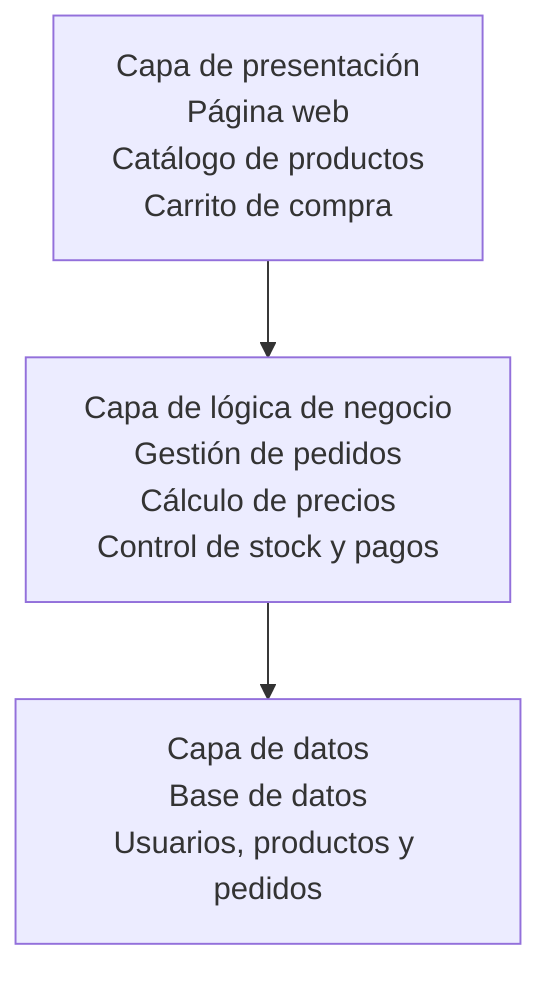

# Actividad 1 — Identificar la arquitectura

**1. Una página web personal con HTML y CSS alojada en un único servidor.**

- **Tipo de arquitectura:** Monolítica.
- **Justificación:** La página está alojada en un único servidor y funciona como un conjunto. Como es una web sencilla que solo utiliza HTML y CSS, no hace falta dividirla en diferentes servicios.

**2. Netflix (catálogo, recomendaciones, pagos, reproducción de vídeo...).**

- **Tipo de arquitectura:** Microservicios.
- **Justificación:** Netflix utiliza microservicios porque sus diferentes funciones, como el catálogo, las recomendaciones o la reproducción de vídeos, pueden funcionar por separado. Así es más fácil actualizar o mejorar una parte sin tener que cambiar toda la aplicación.

**3. Una función que redimensiona automáticamente una imagen cada vez que se sube a un bucket de almacenamiento en la nube.**

- **Tipo de arquitectura:** Serverless (sin servidor).
- **Justificación:** La función se ejecuta automáticamente cuando se sube una imagen a la nube. No hace falta tener un servidor funcionando todo el tiempo, porque el proveedor de la nube se encarga de gestionar la infraestructura y ejecutar la función cuando es necesario.

---

# Actividad 2 — Dibuja el diagrama

**1. Capa de presentación:** es la parte que ve el cliente cuando entra en la tienda online. Incluye la página web, el catálogo de productos y el carrito de compra.

**2. Capa de lógica de negocio:** se encarga de gestionar las operaciones de la tienda, como los pedidos, los precios, el stock y los pagos.

**3. Capa de datos:** guarda toda la información de la tienda en una base de datos, como los usuarios, los productos y los pedidos.

### Diagrama de arquitectura de 3 capas



**Conclusión:** Las tres capas están separadas para tener el código mejor organizado y facilitar los cambios y el mantenimiento de la tienda online.

---

# Actividad 3 — TCP vs UDP

**1. Una videollamada.**

- **Protocolo:** UDP.
- **Justificación:** UDP permite enviar audio y vídeo rápidamente. En una videollamada es mejor que la comunicación sea fluida, aunque se pierda algún dato, que esperar a que se vuelva a enviar. Algunas videollamadas también utilizan TCP.

**2. La descarga de un fichero por HTTP.**

- **Protocolo:** TCP.
- **Justificación:** TCP comprueba que los datos lleguen correctamente y en orden. Así se evita que el archivo se descargue incompleto o con errores. Hay que tener en cuenta que HTTP/3 utiliza QUIC, que funciona sobre UDP.

**3. Una partida online de un videojuego en tiempo real.**

- **Protocolo:** UDP.
- **Justificación:** UDP permite enviar las acciones de los jugadores rápidamente, con menos retraso. En estos juegos es importante recibir información actualizada al momento, en lugar de esperar a que se envíen de nuevo datos antiguos. Algunos juegos también utilizan TCP para otras funciones.

**4. El envío de un correo electrónico.**

- **Protocolo:** TCP.
- **Justificación:** El correo electrónico utiliza normalmente TCP para enviar los mensajes de forma fiable y en el orden correcto, mediante protocolos como SMTP.

### Resumen

| Aplicación | Protocolo habitual |
|---|---|
| Videollamada | UDP |
| Descarga de un fichero por HTTP | TCP |
| Videojuego online en tiempo real | UDP |
| Envío de correo electrónico | TCP |

---

# Actividad 4 — El saludo TCP

El *3-way handshake* es el proceso que utiliza TCP para establecer una conexión entre dos dispositivos. Los mensajes se envían en este orden:

1. **SYN:** el cliente solicita iniciar una conexión con el servidor.
2. **SYN-ACK:** el servidor responde confirmando que ha recibido la solicitud y acepta iniciar la conexión.
3. **ACK:** el cliente confirma la respuesta del servidor y la conexión queda establecida.

**En resumen:** `SYN → SYN-ACK → ACK`

Cuando terminan estos tres pasos, los dos dispositivos ya pueden empezar a intercambiar datos.

---

# Actividad 5 — DNS

Para averiguar la dirección IP de `www.google.com`, podemos abrir una terminal y ejecutar este comando:

```bash
nslookup www.google.com
```

El DNS se encarga de traducir los nombres de dominio, como `www.google.com`, a direcciones IP para que los ordenadores puedan localizar los servidores.

**1. ¿Qué dirección IP ha devuelto?**

Al consultar `www.google.com`, he encontrado direcciones IP como `142.251.150.119` y `142.251.151.119`. La dirección puede cambiar dependiendo de la consulta.

**2. ¿Por qué crees que es necesario este paso antes de poder hacer una petición HTTP?**

Porque el navegador necesita conocer la dirección IP del servidor para poder conectarse a él. El DNS traduce el nombre de la web a una dirección IP, lo que permite localizar el servidor y solicitar la página.

## Actividad 6 — Petición HTTP real

Para hacer esta actividad, he abierto las herramientas de desarrollador del navegador con `F12` y he entrado en la pestaña **Network (Red)**. Después, he visitado una página web y he seleccionado la petición principal para consultar sus datos.

**1. ¿Qué método HTTP se ha usado en la petición principal?**

El método utilizado ha sido `GET`, que sirve para solicitar información al servidor.

**2. ¿Qué código de estado ha devuelto el servidor?**

El servidor ha devuelto el código de estado `200 OK`, que significa que la petición se ha realizado correctamente.

**3. ¿Qué cabeceras (headers) aparecen en la petición y en la respuesta?**

En la petición aparecen cabeceras como `Accept`, `User-Agent` y `Accept-Language`, que indican qué contenido acepta el navegador, qué navegador se está utilizando y qué idioma prefiere el usuario.

En la respuesta pueden aparecer cabeceras como `Content-Type`, `Content-Length` y `Cache-Control`, que indican el tipo de contenido enviado, su tamaño y cómo se puede almacenar en caché.

## Actividad 7 — Códigos de estado

| Código | Significado |
| ------ | ----------- |
| 200    | La petición se ha realizado correctamente. |
| 301    | La página se ha trasladado a otra dirección de forma permanente. |
| 404    | No se ha encontrado la página solicitada. |
| 500    | Ha ocurrido un error interno en el servidor. |

## Actividad 8 — HTTP vs HTTPS

| Característica                          | HTTP | HTTPS |
| --------------------------------------- | ---- | ----- |
| Puerto por defecto                      | 80   | 443   |
| ¿Los datos van cifrados?                | No   | Sí    |
| ¿Se verifica la identidad del servidor? | No   | Sí    |

## Actividad 9 — El handshake TLS

1. El cliente envía `ClientHello` con los algoritmos que soporta.
2. El servidor responde con `ServerHello` eligiendo el cifrado.
3. El servidor envía su certificado digital.
4. El cliente verifica el certificado con la Autoridad de Certificación.
5. El cliente y el servidor acuerdan una clave de sesión simétrica.

## Actividad 10 — Comprobando un certificado

1. **Autoridad de Certificación:** [nombre de la entidad que ha emitido el certificado].
2. **Dominio para el que es válido:** [dominio que aparece en el certificado].
3. **Fecha de validez:** hasta el [fecha de caducidad del certificado].

## Actividad 11 — Reflexión final

Hoy en día casi todas las páginas web utilizan HTTPS porque protege la información que se envía entre el navegador y el servidor. Los datos viajan cifrados, por lo que es más difícil que alguien pueda leerlos o modificarlos. Además, permite comprobar la identidad del servidor mediante su certificado digital. Aunque el handshake TLS añade un poco de latencia al principio, la seguridad y la privacidad que ofrece compensan ese pequeño retraso.
