# Práctica 1. Análisis de HTTP con curl

## 1. Comprobación de una petición HTTP con Edge

**Enunciado:** Acceder a `http://www.example.com/` utilizando el navegador. Abrir las herramientas de desarrollador (F12), entrar en la pestaña Red (Network) y seleccionar la petición principal. Identificar el método HTTP, el código de estado, la cabecera Content-Type y la cabecera Host.

**Desarrollo:**

Para comprobar cómo funciona una petición HTTP, he accedido a `http://www.example.com/` utilizando Microsoft Edge.

En las herramientas de desarrollador, dentro de la pestaña **Red (Network)**, he seleccionado la petición principal y he revisado sus cabeceras.

Los datos que he comprobado son:

- **Método:** GET. Se utiliza para solicitar un recurso al servidor.
- **Estado:** 200 OK. Significa que la petición se ha realizado correctamente.
- **Content-Type:** `text/html; charset=utf-8`. Indica que el servidor devuelve un documento HTML codificado en UTF-8.
- **Host:** `www.example.com`. Identifica el servidor al que se dirige la petición.

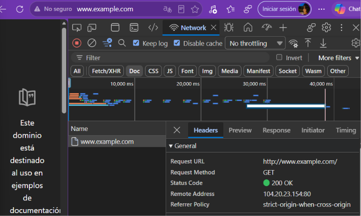

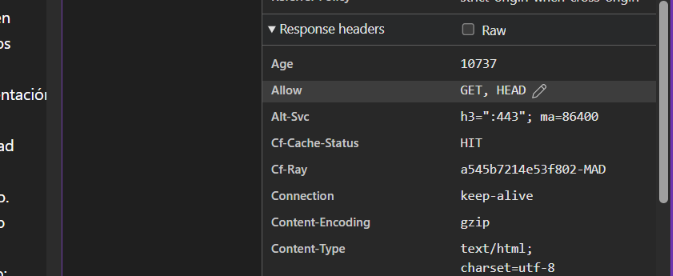

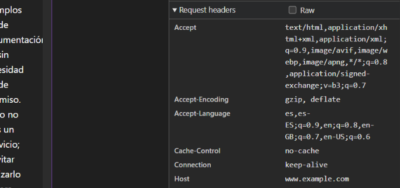

## 2. Comprobación de una petición HTTPS con Edge

**Enunciado:** Acceder a `https://www.google.com/` utilizando el navegador. Inspeccionar la petición en las herramientas de desarrollador y consultar la información del certificado de seguridad. Identificar el puerto utilizado, la autoridad de certificación y el dominio para el que es válido el certificado.

**Desarrollo:**

A continuación, he accedido a `https://www.google.com/` para comprobar una conexión HTTPS.

En las herramientas de desarrollador he revisado las cabeceras de la petición y la información del certificado de seguridad.

He observado lo siguiente:

- La petición utiliza el método GET.
- El servidor devuelve el estado 200 OK.
- La cabecera `alt-svc` anuncia que el servidor también admite HTTP/3.
- La conexión HTTPS utiliza el puerto 443.
- El certificado digital es válido y ha sido emitido por Google Trust Services.
- El certificado corresponde al dominio `*.google.com`.

El certificado permite comprobar la identidad del servidor y ayuda a establecer una conexión segura.

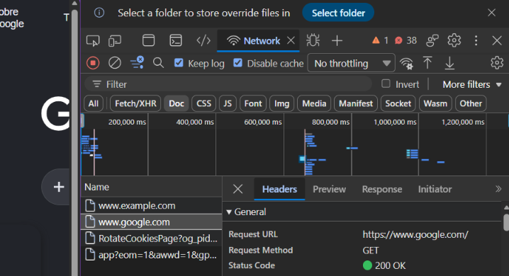

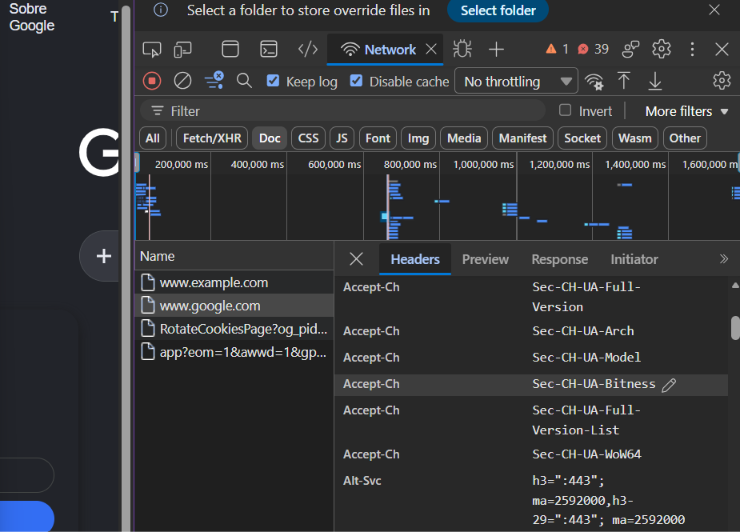

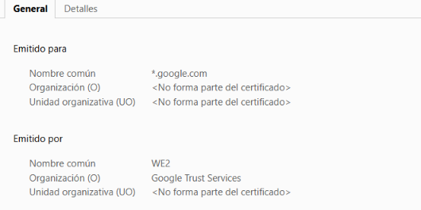

## 3. Consulta de una página HTTP con curl -v

**Enunciado:** Realizar una petición HTTP desde la terminal utilizando `curl -v http://www.example.com`. Observar las cabeceras enviadas por el cliente y las cabeceras y el código de estado devueltos por el servidor.

**Desarrollo:**

Para analizar una petición HTTP desde la terminal, he utilizado el comando:

```bash
curl -v http://neverssl.com
```

La opción `-v` muestra información detallada de la comunicación, tanto de la petición que realiza el cliente como de la respuesta que devuelve el servidor.

En el resultado he podido observar:

- El método GET y la ruta solicitada.
- La cabecera Host.
- El User-Agent, que identifica la versión de curl utilizada.
- La cabecera Accept.
- El estado HTTP 200 OK.
- El servidor que responde y el tipo de contenido devuelto.

Inicialmente intenté realizar esta prueba con `www.example.com`, pero la conexión estaba bloqueada por la red utilizada. Por ese motivo, utilicé NeverSSL para completar la comprobación.

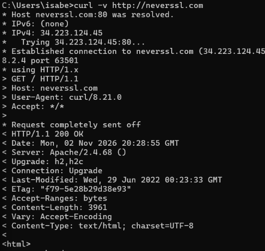

## 4. Consulta de las cabeceras HTTP con curl -I

**Enunciado:** Ejecutar `curl -I http://www.example.com` para consultar únicamente las cabeceras de la respuesta HTTP, sin descargar el contenido de la página. Identificar el código de estado y algunas de las cabeceras recibidas.

**Desarrollo:**

En este apartado he utilizado el siguiente comando:

```bash
curl -I http://neverssl.com
```

La opción `-I` permite consultar únicamente las cabeceras de respuesta, sin descargar el contenido completo de la página.

El servidor ha respondido con el estado `200 OK`.

También he podido observar información como:

- **Server:** identifica el servidor web.
- **Content-Length:** indica el tamaño del contenido.
- **Content-Type:** indica el tipo de documento.
- **Last-Modified:** informa de la última modificación del recurso.
- **ETag:** permite identificar una versión concreta del recurso.

Esta opción resulta útil cuando solo necesitamos consultar información sobre la respuesta del servidor.

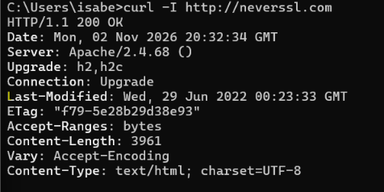

## 5. Consulta de una página HTTPS con curl -v

**Enunciado:** Realizar una petición HTTPS desde la terminal utilizando `curl -v https://www.example.com`. Comparar el resultado con la petición HTTP anterior e identificar los pasos adicionales que aparecen durante el establecimiento de la conexión segura y la información del certificado.

**Desarrollo:**

Para comprobar una conexión HTTPS desde la terminal, he utilizado:

```bash
curl -v https://www.google.com
```

Con la opción `-v` he podido observar información detallada sobre el establecimiento de la conexión y la petición realizada.

La conexión se ha establecido correctamente con el servidor de Google a través del puerto 443 y se ha recibido el contenido HTML de la página.

También he podido observar las cabeceras de la respuesta, como `Server` y `X-Frame-Options`.

Al principio intenté realizar esta prueba con `www.example.com`, pero la conexión se interrumpió durante el establecimiento de la conexión TLS. Por ello, utilicé Google para completar la comprobación.

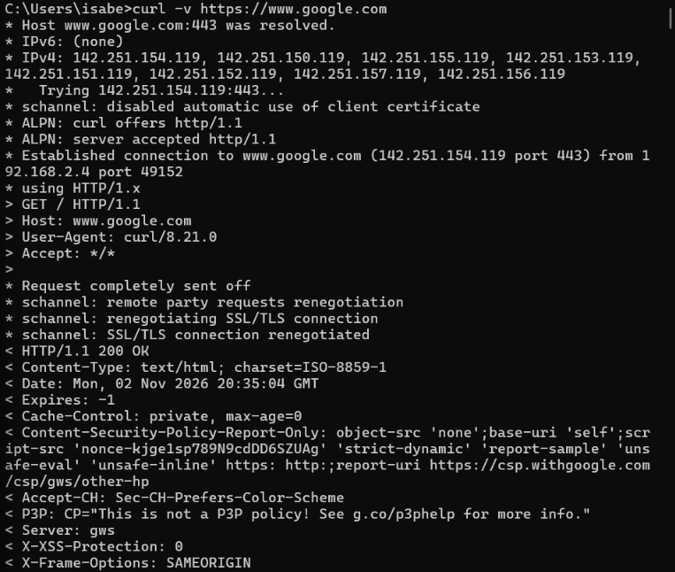

## 6. Comprobación de diferentes códigos de estado HTTP

**Enunciado:** Ejecutar las siguientes peticiones utilizando `curl -I` para comprobar diferentes códigos de estado HTTP:

```bash
curl -I https://httpstat.us/200
curl -I https://httpstat.us/301
curl -I https://httpstat.us/404
curl -I https://httpstat.us/500
```

Identificar el código de estado de cada respuesta y explicar su significado. Completar una tabla con la URL, el código de estado y su significado.

**Desarrollo:**

Para comprobar diferentes respuestas HTTP, he utilizado `curl` junto con la opción `-I`, que permite consultar las cabeceras y el código de estado sin descargar el cuerpo de la respuesta.

He utilizado el servicio HTTPBin para realizar las cuatro pruebas, ya que el servicio httpstat.us no respondía correctamente desde mi conexión.

### 6.1. Código 200 OK

**Comando:**

```bash
curl -I https://httpbin.org/status/200
```

El servidor devuelve `200 OK`, que indica que la petición se ha procesado correctamente.

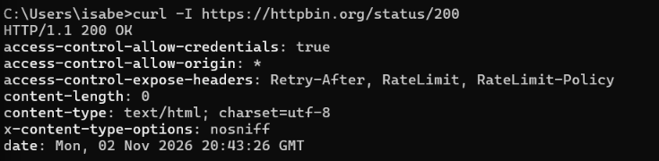

### 6.2. Código 301 Moved Permanently

**Comando:**

```bash
curl -I https://httpbin.org/status/301
```

El servidor devuelve `301 Moved Permanently`. Este código indica que el recurso se ha trasladado de forma permanente.

En la respuesta aparece también la cabecera `Location`, que indica la ruta de redirección.

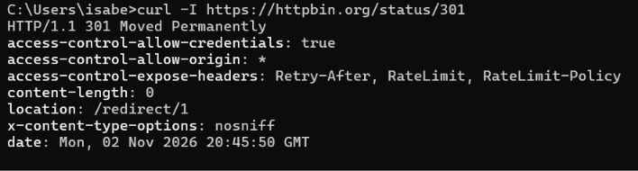

### 6.3. Código 404 Not Found

**Comando:**

```bash
curl -I https://httpbin.org/status/404
```

El servidor devuelve `404 Not Found`, que indica que el recurso solicitado no se ha encontrado.

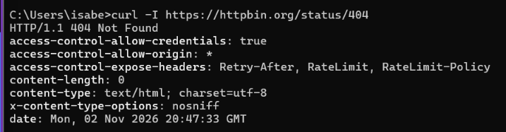

### 6.4. Código 500 Internal Server Error

**Comando:**

```bash
curl -I https://httpbin.org/status/500
```

El servidor devuelve `500 Internal Server Error`. Este código indica que se ha producido un error interno al procesar la petición.

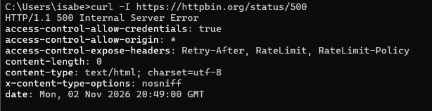

### Tabla resumen de los códigos de estado

| URL | Código de estado | Significado |
|---|---|---|
| `https://httpbin.org/status/200` | 200 OK | La petición se ha procesado correctamente. |
| `https://httpbin.org/status/301` | 301 Moved Permanently | El recurso se ha trasladado permanentemente. |
| `https://httpbin.org/status/404` | 404 Not Found | El recurso solicitado no se ha encontrado. |
| `https://httpbin.org/status/500` | 500 Internal Server Error | Se ha producido un error interno en el servidor. |

## 7. Envío de datos mediante una petición POST

**Enunciado:** Ejecutar la siguiente petición POST para enviar datos a un servidor:

```bash
curl -X POST -d "nombre=tunombre&curso=DAW" https://httpbin.org/post
```

Observar la respuesta JSON e identificar dónde aparecen los datos enviados.

**Desarrollo:**

Por último, he realizado una petición POST para enviar datos a un servidor utilizando el siguiente comando:

```bash
curl -X POST -d "nombre=Isabel&curso=DAW" https://httpbin.org/post
```

La opción `-X POST` indica el método utilizado y `-d` permite enviar los datos del formulario.

El servidor HTTPBin ha recibido correctamente la información y la ha devuelto en formato JSON.

En la respuesta se puede comprobar:

- **method:** POST, que confirma el método utilizado.
- **Content-Type:** `application/x-www-form-urlencoded`, que indica el formato de los datos enviados.
- **form:** contiene los campos recibidos, en este caso `nombre` y `curso`.

Esta prueba permite comprobar cómo se pueden enviar datos a un servidor mediante una petición POST.

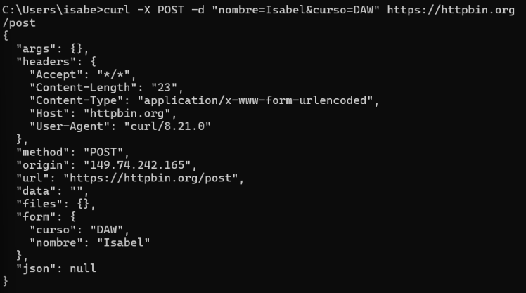

---


## 8. Preguntas finales

### 8.1. ¿Qué diferencias principales has observado entre una petición HTTP y una HTTPS?

HTTP permite la comunicación entre un navegador y un servidor web, pero los datos se transmiten sin cifrar.

HTTPS utiliza HTTP junto con una capa de seguridad TLS. De esta forma, la información que se transmite va cifrada y resulta más difícil que otras personas puedan leerla o modificarla durante la comunicación.

La diferencia principal es que HTTPS proporciona una comunicación más segura que HTTP.

### 8.2. ¿Por qué crees que es importante comprobar el certificado de un sitio web antes de introducir datos sensibles (contraseñas, tarjetas de crédito...)?

Es importante porque el certificado digital permite verificar la identidad del servidor web y comprobar que corresponde al dominio al que queremos acceder.

Así podemos reducir el riesgo de conectarnos a una página falsa que intente hacerse pasar por otra y proteger nuestros datos personales y bancarios.

### 8.3. ¿Qué ventaja tiene usar `curl` frente a las herramientas de desarrollador del navegador a la hora de automatizar pruebas?

`curl` permite realizar peticiones a servidores desde la terminal, sin necesidad de utilizar un navegador.

Una de sus principales ventajas es que permite repetir peticiones mediante scripts y automatizar comprobaciones. También permite utilizar diferentes métodos, como GET y POST, consultar las cabeceras y mostrar información detallada de las conexiones mediante la opción `-v`.


