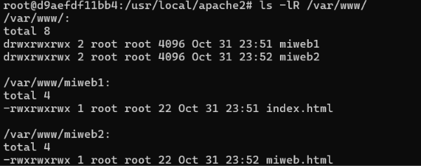
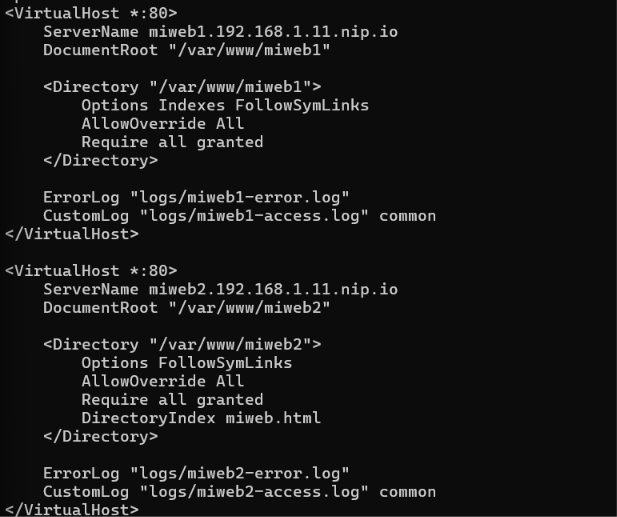
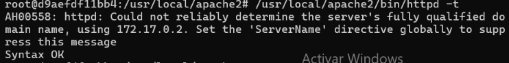
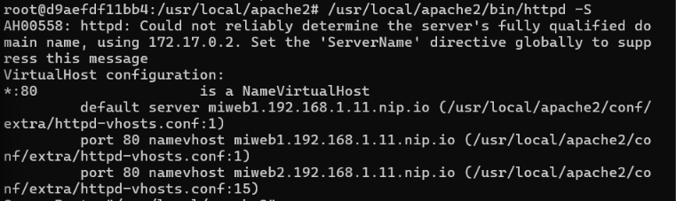
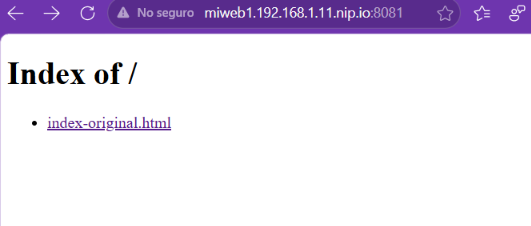
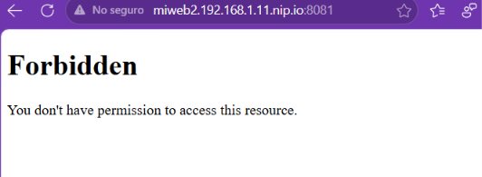

# Práctica 3. Configuración de VirtualHost en Apache

En esta práctica he trabajado con dos sitios web en un mismo servidor Apache, utilizando VirtualHost para diferenciarlos mediante nombres de dominio.

He realizado la práctica en casa con Docker y también he trabajado el procedimiento en clase utilizando una máquina virtual Linux a la que me conectaba mediante SSH.

## 1. Trabajo realizado con Docker

Para realizar la práctica  he creado un contenedor independiente llamado `virtualhost`, utilizando la imagen `httpd:latest` y publicando el puerto 8081 del equipo local hacia el puerto 80 del contenedor.

Como la imagen oficial de Apache utiliza una estructura de configuración diferente a la de Linux, he adaptado los VirtualHost al archivo `httpd-vhosts.conf`, incluido desde `httpd.conf`.

### 1.1. Creación de directorios y archivos

He creado dos directorios para alojar las páginas web:

- `/var/www/miweb1`
- `/var/www/miweb2`

En el primero he creado `index.html` y en el segundo `miweb.html`.



### 1.2. Configuración de los VirtualHost

He configurado dos bloques VirtualHost con sus respectivos `ServerName` y `DocumentRoot`.

En el primer sitio he activado `Indexes` para permitir mostrar el listado de archivos cuando no existe el archivo de inicio.

En el segundo he utilizado `DirectoryIndex miweb.html` para indicar que ese archivo debe ser la página principal.



### 1.3. Comprobación de la configuración

He comprobado que la configuración no tuviera errores:

```bash
/usr/local/apache2/bin/httpd -t
```

El resultado fue `Syntax OK`.



También he comprobado que Apache reconocía los dos VirtualHost:

```bash
/usr/local/apache2/bin/httpd -S
```



### 1.4. Prueba de las páginas web

He accedido desde el navegador a las dos direcciones:

- `http://miweb1.192.168.1.11.nip.io:8081`
- `http://miweb2.192.168.1.11.nip.io:8081`

Las dos páginas mostraron correctamente sus respectivos mensajes.


### 1.5. Comprobación de Indexes

Para comprobar el comportamiento de `Indexes`, he renombrado temporalmente los archivos de inicio.

En Mi Web 1 apareció un listado de archivos porque tenía activada la opción `Indexes`.



En Mi Web 2 apareció un error `403 Forbidden`, porque no tenía activada la navegación de directorios y tampoco encontraba su archivo de índice.



Después he restaurado los nombres originales y he comprobado que ambas páginas volvían a funcionar.

---

## 2. Procedimiento realizado en clase con Linux y SSH

En clase he realizado la práctica utilizando una máquina virtual Linux que ya tenía Apache instalado. Me conectaba desde la terminal del ordenador local mediante SSH.

### 2.1. Conexión y comprobación de la IP

Primero me he conectado a la máquina virtual:

```bash
ssh usuario@IP
```

Una vez dentro, he consultado la dirección IP:

```bash
ip a
```

Después he comprobado que `nip.io` resolvía correctamente el dominio:

```bash
ping -c 3 miweb1.IP.nip.io
```

`nip.io` permite utilizar nombres de dominio asociados a una dirección IP sin tener que modificar el archivo `hosts`.

### 2.2. Creación de las páginas web

He creado los directorios:

```bash
sudo mkdir -p /var/www/miweb1
sudo mkdir -p /var/www/miweb2
```

He creado los archivos HTML:

```bash
sudo nano /var/www/miweb1/index.html
sudo nano /var/www/miweb2/miweb.html
```

En cada archivo he escrito el contenido de su página web.

He dado permisos a los directorios para trabajar en el entorno de desarrollo:

```bash
sudo chmod -R 777 /var/www/miweb1
sudo chmod -R 777 /var/www/miweb2
```

### 2.3. Creación de los VirtualHost

Me he situado en el directorio donde Apache guarda las configuraciones disponibles:

```bash
cd /etc/apache2/sites-available
```

He copiado la configuración predeterminada para crear los dos archivos:

```bash
sudo cp 000-default.conf miweb1.conf
sudo cp 000-default.conf miweb2.conf
```

He editado cada archivo:

```bash
sudo nano miweb1.conf
sudo nano miweb2.conf
```

En ambos he configurado las directivas principales:

- `ServerName`: indica el nombre de dominio que identifica cada web.
- `DocumentRoot`: indica la carpeta donde están sus archivos.
- `ErrorLog`: indica dónde se guardan los errores.
- `CustomLog`: indica dónde se guarda el registro de accesos.

También he configurado las opciones de cada directorio:

**Mi Web 1:**

```apache
<Directory /var/www/miweb1>
    Options Indexes FollowSymLinks
    AllowOverride None
    Require all granted
</Directory>
```

**Mi Web 2:**

```apache
<Directory /var/www/miweb2>
    Options FollowSymLinks
    DirectoryIndex miweb.html
    AllowOverride None
    Require all granted
</Directory>
```

La diferencia principal es que Mi Web 1 tiene activada la opción `Indexes`, mientras que Mi Web 2 utiliza `DirectoryIndex miweb.html` para indicar su archivo de inicio.

### 2.4. Activación de los sitios

Una vez creados los archivos, he habilitado los dos VirtualHost:

```bash
sudo a2ensite miweb1.conf
sudo a2ensite miweb2.conf
```

Opcionalmente, he deshabilitado el sitio predeterminado:

```bash
sudo a2dissite 000-default.conf
```

He comprobado que la configuración no tuviera errores:

```bash
sudo apache2ctl configtest
```

El resultado esperado es:

```text
Syntax OK
```

Por último, he recargado Apache para aplicar los cambios:

```bash
sudo systemctl reload apache2
```

### 2.5. Comprobación de las páginas

Desde el navegador he accedido a los dos dominios:

```text
http://miweb1.IP.nip.io
http://miweb2.IP.nip.io
```

He comprobado que cada dominio mostraba su propia página web.

Para probar `Indexes`, he renombrado temporalmente los archivos:

```bash
sudo mv /var/www/miweb1/index.html /var/www/miweb1/otro.html
sudo mv /var/www/miweb2/miweb.html /var/www/miweb2/otro.html
```

- En Mi Web 1 aparece un listado de archivos porque tiene activada la opción `Indexes`.
- En Mi Web 2 aparece un error `403 Forbidden` porque no permite mostrar el listado y no encuentra el archivo indicado en `DirectoryIndex`.

Finalmente, he restaurado los nombres originales:

```bash
sudo mv /var/www/miweb1/otro.html /var/www/miweb1/index.html
sudo mv /var/www/miweb2/otro.html /var/www/miweb2/miweb.html
```

---

## 3. Comandos importantes para el examen

| Comando | Función |
|---|---|
| `ip a` | Muestra las interfaces y direcciones IP. |
| `ping -c 3 dominio` | Comprueba la conexión y resolución del dominio. |
| `sudo mkdir -p` | Crea directorios. |
| `sudo nano archivo` | Crea o edita un archivo. |
| `sudo chmod -R 777 carpeta` | Da permisos de lectura, escritura y ejecución. |
| `cd /etc/apache2/sites-available` | Accede a las configuraciones disponibles. |
| `sudo cp origen destino` | Copia un archivo. |
| `sudo a2ensite archivo.conf` | Habilita un sitio web. |
| `sudo a2dissite archivo.conf` | Deshabilita un sitio web. |
| `sudo apache2ctl configtest` | Comprueba la sintaxis de Apache. |
| `sudo systemctl reload apache2` | Recarga la configuración de Apache. |
| `sudo mv origen destino` | Renombra o mueve un archivo. |

### Diferencia entre sites-available y sites-enabled

- `sites-available`: contiene los archivos de configuración de los sitios disponibles.
- `sites-enabled`: contiene los sitios que están habilitados para que Apache los utilice.
- `a2ensite`: habilita un sitio, creando el enlace correspondiente en `sites-enabled`.
- `a2dissite`: deshabilita un sitio, eliminando ese enlace.

### Diferencia entre reload y restart

- `reload`: aplica los cambios de configuración sin detener completamente Apache.
- `restart`: detiene y vuelve a iniciar el servicio.

---

## 4. Preguntas finales

**1. ¿Qué directiva permite a Apache distinguir entre miweb1 y miweb2?**

La directiva `ServerName`, porque identifica el nombre de dominio de cada VirtualHost, aunque ambos utilicen la misma IP y el mismo puerto.

**2. ¿Qué ventaja tiene utilizar nip.io?**

Permite resolver nombres de dominio hacia una dirección IP sin modificar el archivo `hosts` ni necesitar permisos de administrador.

**3. ¿Qué riesgo tiene activar Indexes en producción?**

Puede mostrar archivos y directorios que no deberían estar accesibles públicamente, exponiendo información del servidor.

**4. ¿Qué pasaría si creo un tercer VirtualHost con el mismo ServerName que miweb1?**

Se produciría un conflicto porque dos sitios tendrían el mismo nombre. Apache normalmente utilizaría el primer VirtualHost que coincida con ese nombre y podría mostrar un aviso de configuración duplicada.


