# Práctica 4 — mod_rewrite

## 1. Activar el módulo mod_rewrite

En primer lugar, activé el módulo `mod_rewrite` de Apache para poder utilizar reglas de reescritura de URL.

Como estamos trabajando con el contenedor Docker `virtualhost`, habilité el módulo en el archivo de configuración `httpd.conf`, quitando el comentario de la siguiente línea:

```apache
LoadModule rewrite_module modules/mod_rewrite.so
```

Después comprobé que la configuración no tenía errores y que el módulo estaba cargado:

```bash
docker exec virtualhost httpd -t
docker exec virtualhost httpd -M | grep rewrite
```

El resultado confirmó que el módulo estaba activo.

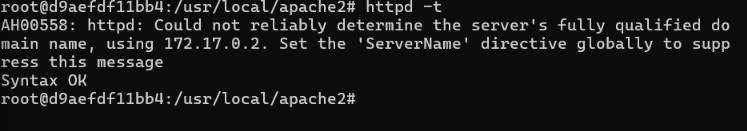

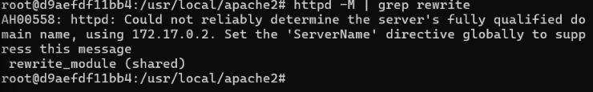

**Cómo hacerlo en clase o en el examen con Linux:**

Primero, desde la terminal local de Windows, me conectaría a la máquina virtual mediante SSH:

```bash
ssh alumno@127.0.0.1 -p 2222
```

Una vez dentro de Linux, activaría el módulo con:

```bash
sudo a2enmod rewrite
sudo systemctl reload apache2
```

Para comprobar que está cargado:

```bash
sudo apache2ctl -M | grep rewrite
```

Debe aparecer `rewrite_module (shared)`.

## 2. Permitir el uso de archivos .htaccess

Para que Apache pudiera aplicar las reglas definidas en archivos `.htaccess`, modifiqué la directiva `AllowOverride` del directorio correspondiente, cambiando su valor de `None` a `All`.

La configuración quedó así:

```apache
<Directory "/usr/local/apache2/htdocs">
    AllowOverride All
</Directory>
```

También comprobé que la configuración de Apache seguía siendo correcta.

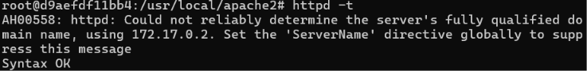

**Cómo hacerlo en clase o en el examen con Linux:**

Editaríamos el archivo de configuración de Apache:

```bash
sudo nano /etc/apache2/apache2.conf
```

Buscaríamos el bloque del directorio web y comprobaríamos que tiene:

```apache
<Directory /var/www/html>
    Options Indexes FollowSymLinks
    AllowOverride All
    Require all granted
</Directory>
```

Guardaríamos los cambios y comprobaríamos la configuración:

```bash
sudo apache2ctl configtest
sudo systemctl reload apache2
```

## 3. Crear el archivo .htaccess

A continuación, creé el archivo `.htaccess` para activar el motor de reescritura.

El archivo se encuentra en el directorio utilizado por el VirtualHost `miweb1`:

`/var/www/miweb1/.htaccess`

Su contenido inicial fue:

```apache
RewriteEngine On
```

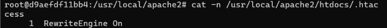

**Cómo hacerlo en clase o en el examen con Linux:**

Si trabajamos con el directorio web predeterminado de Apache, crearíamos el archivo así:

```bash
sudo nano /var/www/html/.htaccess
```

Y escribiríamos:

```apache
RewriteEngine On
```

## 4. Crear una redirección simple

En este apartado creé una página llamada `nuevo.html` y añadí una regla para que, al acceder a la dirección `/viejo`, Apache redirigiera automáticamente a `/nuevo.html`.

La regla utilizada fue:

```apache
RewriteRule ^viejo$ /nuevo.html [R=301,L]
```

- `R=301` indica que se trata de una redirección permanente.
- `L` indica que no se deben seguir procesando más reglas si esta coincide.

Comprobé el funcionamiento con el siguiente comando:

```bash
curl.exe -I http://localhost:8081/viejo
```

La respuesta fue `301 Moved Permanently`, indicando que la redirección funcionaba correctamente.

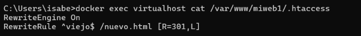

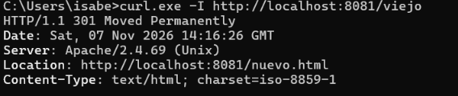

**Cómo hacerlo en clase o en el examen con Linux:**

Crearíamos la página nueva:

```bash
echo "<h1>Página nueva</h1>" | sudo tee /var/www/html/nuevo.html
```

Editaríamos el archivo `.htaccess`:

```bash
sudo nano /var/www/html/.htaccess
```

Y añadiríamos:

```apache
RewriteEngine On
RewriteRule ^viejo$ /nuevo.html [R=301,L]
```

Para comprobar la redirección:

```bash
curl -I http://localhost/viejo
```

El resultado esperado es `301 Moved Permanently`.

## 5. Crear URLs amigables

Después creé una página llamada `producto.html` y añadí una regla para poder acceder a ella mediante una URL más sencilla, sin mostrar directamente el nombre del archivo.

La regla utilizada fue:

```apache
RewriteRule ^producto/([0-9]+)$ /producto.html?id=$1 [L]
```

Esta regla permite acceder, por ejemplo, a `/producto/15`, que Apache transforma internamente en una petición a `producto.html?id=15`.

Para comprobarlo utilicé:

```bash
curl.exe -I http://localhost:8081/producto/15
```

El resultado fue `200 OK`, por lo que la reescritura funcionaba correctamente.

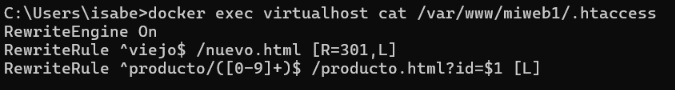

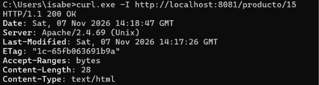

**Cómo hacerlo en clase o en el examen con Linux:**

Crearíamos la página:

```bash
echo "<h1>Mostrando producto</h1>" | sudo tee /var/www/html/producto.html
```

Editaríamos el `.htaccess`:

```bash
sudo nano /var/www/html/.htaccess
```

Y añadiríamos la regla:

```apache
RewriteRule ^producto/([0-9]+)$ /producto.html?id=$1 [L]
```

Comprobaríamos el resultado:

```bash
curl -I http://localhost/producto/15
```

Debe devolver `200 OK`.

## 6. Bloquear un User-Agent

En este apartado añadí una condición para bloquear las peticiones procedentes de un User-Agent que comenzara por `BadBot`.

Las reglas añadidas al archivo `.htaccess` fueron:

```apache
RewriteCond %{HTTP_USER_AGENT} ^BadBot [NC]
RewriteRule ^.*$ - [F,L]
```

La condición comprueba el User-Agent de la petición y, si coincide, la regla devuelve un error `403 Forbidden`, impidiendo el acceso.

Para comprobarlo ejecuté:

```bash
curl.exe -I -A "BadBot" http://localhost:8081/
```

Apache respondió con `403 Forbidden`, confirmando que el bloqueo funcionaba correctamente.

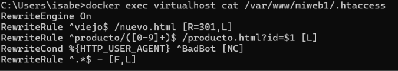

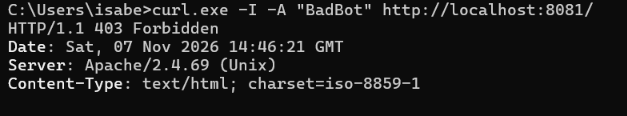

**Cómo hacerlo en clase o en el examen con Linux:**

Editaríamos el archivo:

```bash
sudo nano /var/www/html/.htaccess
```

Y añadiríamos:

```apache
RewriteCond %{HTTP_USER_AGENT} ^BadBot [NC]
RewriteRule ^.*$ - [F,L]
```

Para probarlo:

```bash
curl -I -A "BadBot" http://localhost/
```

El resultado esperado es `403 Forbidden`.

## 7. Depuración de las reglas

Por último, activé el registro detallado de `mod_rewrite` para poder comprobar cómo Apache procesa las reglas de reescritura.

Añadí la siguiente directiva en el VirtualHost de `miweb1`:

```apache
LogLevel warn rewrite:trace3
```

Después comprobé la sintaxis y reinicié Apache para aplicar los cambios.

Para generar actividad, volví a acceder a la URL amigable:

```bash
curl.exe -I http://localhost:8081/producto/15
```

Finalmente, consulté el registro de errores del VirtualHost:

```bash
docker exec virtualhost tail -n 30 /usr/local/apache2/logs/miweb1-error.log
```

En el registro aparecieron diferentes mensajes de depuración que mostraban cómo Apache evaluaba las reglas y realizaba la reescritura interna hacia `producto.html`.

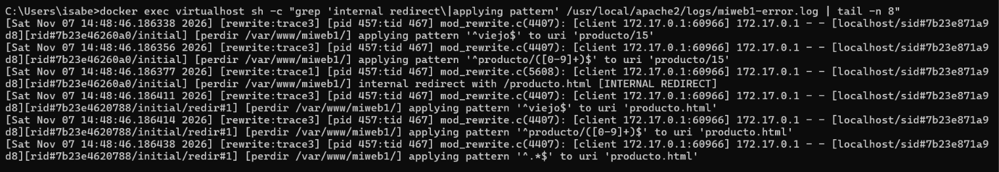

**Cómo hacerlo en clase o en el examen con Linux:**

Editaríamos el archivo de configuración del VirtualHost:

```bash
sudo nano /etc/apache2/sites-available/000-default.conf
```

Dentro del bloque `<VirtualHost *:80>`, añadiríamos:

```apache
LogLevel warn rewrite:trace3
```

Comprobaríamos la configuración y recargaríamos Apache:

```bash
sudo apache2ctl configtest
sudo systemctl reload apache2
```

Para generar una petición de prueba:

```bash
curl -I http://localhost/producto/15
```

Y consultaríamos el registro:

```bash
sudo tail -f /var/log/apache2/error.log
```

Para salir del registro en tiempo real, pulsaríamos `Ctrl + C`.

## Preguntas finales

**1. ¿Qué ocurre si olvidas añadir la bandera [L] en una regla de reescritura y hay más reglas después?**

Apache continúa procesando las siguientes reglas, aunque la anterior haya coincidido. Esto puede provocar nuevas reescrituras o resultados no deseados.

**2. ¿Por qué es necesario AllowOverride All para que funcionen las reglas definidas en un .htaccess?**

Porque permite que Apache acepte las directivas de configuración incluidas en los archivos `.htaccess`. Si está configurado como `None`, Apache ignora esas reglas.

**3. ¿Qué diferencia hay entre RewriteRule y RewriteCond?**

`RewriteRule` establece el patrón que debe coincidir y la acción que se realizará. `RewriteCond` establece una condición que debe cumplirse para que se aplique la siguiente regla.

**4. ¿Qué ventaja de rendimiento tendría mover las reglas del .htaccess directamente al VirtualHost?**

Mejora el rendimiento porque Apache no necesita buscar y leer los archivos `.htaccess` en cada petición. Además, permite centralizar la configuración.

**5. En la regla de URLs amigables del apartado 5, ¿qué representa $1 y de dónde proviene su valor?**

`$1` representa el valor capturado por el primer grupo de la expresión regular `([0-9]+)`. En nuestro ejemplo, al acceder a `/producto/15`, su valor es `15` y se utiliza como identificador del producto.